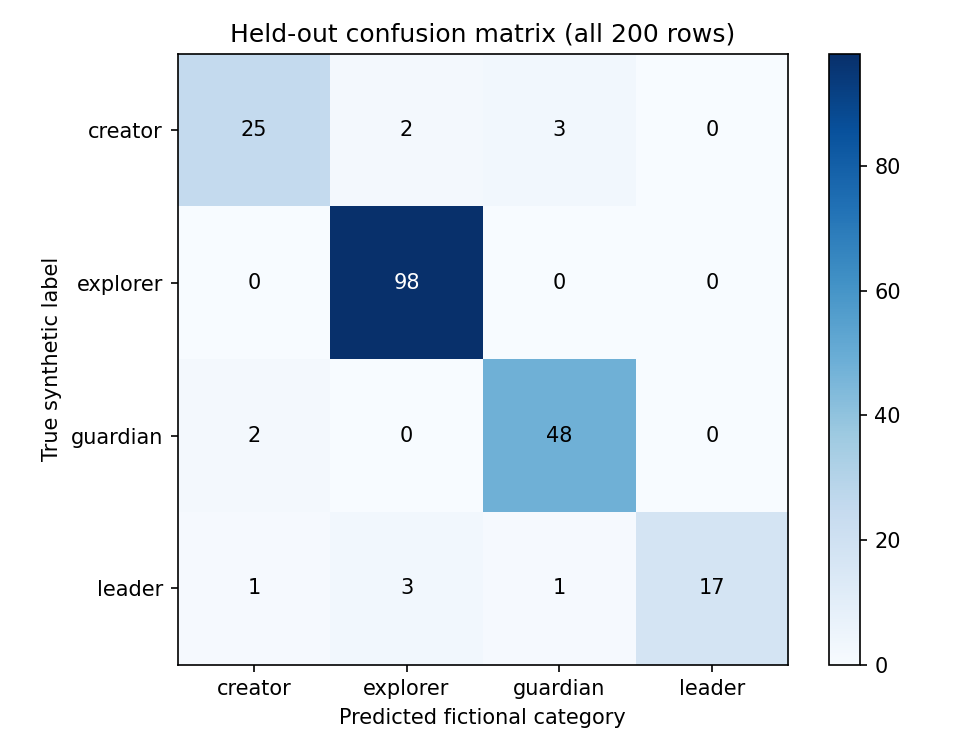

# Archetype Classifier Agent

[](https://github.com/ryancramer06/archetype-classifier-agent/actions/workflows/tests.yml)

A Python classifier that turns six synthetic measurements into a fictional
category, an uncertainty decision, and an explanation of the model's score.
The project covers the full workflow: input validation, reproducible training,
cross-validation, evaluation, saved-model prediction, and automated tests.

The goal is to make a small classifier's behavior easy to inspect. The labels
`explorer`, `guardian`, `creator`, and `leader` are invented names for patterns
in generated data. They do not describe real people's personalities or abilities.

## Features

- A saved `StandardScaler` + `LogisticRegression` pipeline with training-only
  scaling and five-fold model selection.
- Strict JSON validation, including Boolean, range, duplicate-key, and
  unexpected-feature checks.
- A fixed acceptance threshold with `ok`, `uncertain`, `invalid_input`, and
  operational `unavailable` responses.
- Signed local feature contributions and class-specific coefficient plots.
- Single requests, a batch of 22 examples, and a readable example runner.
- A standard-library predictor using the same fitted parameters, suitable for
  running without scientific packages on a Raspberry Pi.

## Quick start: no packages required

Use Python **3.11, 3.12, or 3.13**. Clone the repository and run from its root:

```bash
git clone https://github.com/ryancramer06/archetype-classifier-agent.git
cd archetype-classifier-agent
python demo.py --backend portable --auto
python predict.py --backend portable --request samples/requests/valid_explorer.json
python batch.py --backend portable
```

On Linux/macOS, use `python3` if `python` is unavailable. Omit `--auto` to pause
between examples. Add `--format json` to the example runner for full responses.
The portable backend reuses exported scaler means/scales, coefficients,
intercepts, and class order; it does not fit a separate model.

## Install for training and sklearn prediction

`requirements-core.txt` contains the five inference dependencies. The full
`requirements.txt` also pins the plotting dependencies used by training and
report generation. Downloads need an internet connection.

Windows PowerShell, from the cloned project directory:

```powershell
python -m venv .venv
.\.venv\Scripts\python.exe -m pip install --only-binary=:all: -r requirements.txt
.\.venv\Scripts\python.exe -m pip check
.\.venv\Scripts\python.exe demo.py --auto
```

Linux/macOS:

```bash
python3 -m venv .venv
.venv/bin/python -m pip install --only-binary=:all: -r requirements.txt
.venv/bin/python -m pip check
.venv/bin/python demo.py --auto
```

Activation is optional because the commands name the environment's Python.
Use that interpreter for every training/sklearn command below. The default
backend for the CLI is `sklearn`; the `ArchetypeAgent` Python class defaults to
`portable`. Native prediction checks the recorded package versions.

## Inspect, train, evaluate, predict

Windows PowerShell:

```powershell
# Inspect the fixed split without fitting or writing artifacts.
.\.venv\Scripts\python.exe train.py --preview-split

# Select a model, refit on training rows, and regenerate saved artifacts/reports.
.\.venv\Scripts\python.exe train.py

# Reload that model and recheck the held-out results without fitting.
.\.venv\Scripts\python.exe evaluate.py
Start-Process -FilePath .\reports\index.html

# Predict individual requests using the saved pipeline.
.\.venv\Scripts\python.exe predict.py --request samples/requests/valid_explorer.json
.\.venv\Scripts\python.exe predict.py --request samples/requests/uncertain.json
.\.venv\Scripts\python.exe predict.py --request samples/requests/boolean_feature.json
```

On Linux/macOS, replace `.\.venv\Scripts\python.exe` with `.venv/bin/python`
and open `reports/index.html` in a browser. Retraining overwrites the model,
reports, and generated example requests. Prediction never retrains the model.

The split is stratified 80/20 with seed 317: **800 training and 200 test rows**.
The search compares `C = [0.01, 0.1, 1, 10]` and `class_weight = [None, balanced]`
on the same five training folds. Mean macro F1 chooses the winner. The scaler
is inside the pipeline, so each fold learns preprocessing from its own training
rows. Labels and row IDs never become predictors.

## Request and response

Example request from `samples/requests/valid_explorer.json`:

```json
{
  "schema_version": "1.0.0",
  "request_id": "demo-explorer",
  "features": {
    "palm_width": 9.156,
    "palm_length": 18.7835,
    "finger_ratio": 1.0484,
    "face_width": 14.7263,
    "face_height": 17.9418,
    "eye_distance": 6.9732
  }
}
```

The bundled model returns the following decision fields (the complete response
also contains probabilities, explanations, warnings, and timing):

```json
{
  "status": "ok",
  "category": "explorer",
  "confidence": 0.998491719609,
  "confidence_type": "uncalibrated_model_probability",
  "acceptance_threshold": 0.6
}
```

All six features are required and bounds are inclusive. The accepted ranges and
all response fields are documented in the [JSON contract](docs/CONTRACT.md).

| Status | Meaning | Prediction CLI exit code |
| --- | --- | ---: |
| `ok` | Valid input; highest probability is at least 0.60 | 0 |
| `uncertain` | Valid input below that threshold; category is null | 1 |
| `invalid_input` | Request or measurement validation failed | 2 |
| `unavailable` | Saved model/dependencies could not be used | 3 |

An output-write failure returns exit code 4. Expected uncertainty/rejection
codes are normal behavior; they do not indicate a crashed program.

## Batch requests and saved responses

```bash
python batch.py --backend portable
python predict.py --backend portable --request samples/requests/valid_creator.json --output local_results/creator.json
python batch.py --backend portable --folder samples/requests --output-dir local_results/my_batch
```

The bundled batch should report **22/22 checks passed**. A PASS can mean an
invalid request was correctly rejected. It is a contract check, not 100% model
accuracy. Custom request folders have no expected labels; their completion
does not establish classification correctness. Generated responses stay in the
ignored `local_results/` folder. `predict.py --stdin` also accepts piped JSON.

## Measured results

Results use all **200 held-out synthetic examples**, before applying uncertainty:

| Model | Accuracy | Macro F1 |
| --- | ---: | ---: |
| Always predict the training majority (`explorer`) | 0.490 | 0.1644 |
| Selected logistic regression | 0.940 | 0.9125 |

The selected settings are **C = 10, no class weighting**. Mean CV macro F1 is
0.8666; macro one-versus-rest AUC on the test set is 0.9710. Balanced weighting
improved minority-class recall but lowered selection macro F1. At the fixed
0.60 threshold, coverage is 96% and accepted-case accuracy is about 94.79%.



Rows are true labels; columns are predictions. See the
[full evaluation](reports/evaluation.md), [ROC curves](reports/roc_curves.png),
and [CV comparison](reports/cv_comparison.png). These scores describe an
artificial classification task, not real-world personal assessment.

## Tests

Standard-library tests, with scientific-package tests explicitly skipped:

```bash
python -S -m unittest discover -s tests -v
```

Full suite after installing dependencies:

```powershell
.\.venv\Scripts\python.exe -m unittest discover -s tests -v
```

Use `.venv/bin/python` on Linux/macOS. The full suite contains **51 tests**.
It covers validation boundaries, CLI responses and exit codes, damaged model
files, readable output, split isolation, fold scaling, save/load consistency,
and portable/sklearn agreement on all 1,000 rows. See
[testing notes](docs/testing.md) for actual environments and limitations.

For formatting changes, install `requirements-dev.txt` and run
`python -m black --check --workers 1 .`.

## Raspberry Pi

Copy or clone the folder to `~/Desktop/archetype-classifier-agent`, then:

```bash
cd ~/Desktop/archetype-classifier-agent
python3 demo.py --backend portable
python3 scripts/pi_check.py
```

The portable option needs no package installation. For 64-bit Raspberry Pi OS
with Python 3.13, `bash scripts/setup_pi.sh --core` installs the pinned native
dependencies. A Git clone downloads packages; optional locally supplied wheels
are checksum-verified for offline installation. See [Pi setup](docs/raspberry-pi.md).
Desktop checks are not evidence of physical Pi execution.

## Layout

```text
archetype-classifier-agent/
  agent.py, predict.py          Validation, model loading, and prediction
  train.py, evaluate.py         Model selection and held-out evaluation
  data_utils.py, config.py      Dataset checks and shared input contract
  evaluation_utils.py           Metrics, reports, and plots
  demo.py, batch.py             Readable examples and many-request checks
  data/                        Unchanged synthetic dataset and card
  models/                      Saved pipeline, parameters, metadata, reference vectors
  samples/                     Valid, uncertain, and invalid JSON requests
  reports/                     Evaluation tables and figures
  tests/                       Unit and integration tests
  scripts/                     Request generation and Pi/cache checks
  docs/                        Architecture, testing, usage, and development decisions
  evidence/                    Recorded verification summaries
  .github/workflows/            Automated checks
```

## Design and limits

The core pipeline and evaluation already existed in the supplied project.
Repository preparation added stronger saved-model validation, readable output,
split previewing, clone-friendly setup, regression tests, and CI. The
[development log](docs/development-log.md) distinguishes those changes.
[Architecture](docs/architecture.md) explains the modules and local score
formula; the [walkthrough](docs/walkthrough.md) covers common implementation questions.

Probabilities are uncalibrated. The 0.60 rule is predeclared, not an optimized
confidence guarantee or a reliable out-of-distribution detector. Contributions
explain linear scores, not causes or probability-point changes. Logistic
regression can miss nonlinear patterns. Native joblib artifacts must be trusted;
checksum checks detect accidental changes, not malicious replacement of both
an artifact and its metadata.

Possible improvements are training-only probability calibration, nested
cross-validation for model comparisons, and a small form that displays the
existing input contract. None is claimed as implemented.

## Data and licensing

Code and project-authored documentation use the [MIT license](LICENSE).
The instructor-supplied synthetic dataset has separate educational-use terms,
retained unchanged in its card. Model artifacts and dataset-derived examples
are not relicensed by the code license. See [third-party notices](THIRD_PARTY_NOTICES.md),
[dataset details](docs/DATASET.md), and [sources](docs/SOURCES.md).
