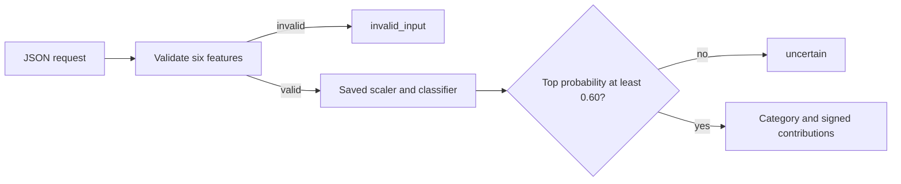

# Architecture and decisions

## Two separate workflows

Training validates the unchanged dataset, reserves the test rows, searches on
training folds, refits the winning pipeline on 800 rows, and evaluates on the
200 held-out rows. It writes the fitted pipeline, portable parameters, split,
metadata, report, and request examples. `train.py --preview-split` only reads
and displays the deterministic split; it does not fit or write artifacts.

Prediction validates one request and loads a previously fitted model. It
computes probabilities, applies the saved threshold, and returns a decision.
No fitting, cross-validation, or parameter selection occurs during prediction.

## Module boundaries

`config.py` defines feature order, ranges, schema, fixed threshold, and data
hashes. `data_utils.py` verifies the original CSV/card and class counts.
`train.py` owns splitting and model selection; `evaluation_utils.py` owns metrics
and reports. `evaluate.py` reloads the saved model and checks held-out metrics.
`agent.py` validates requests and model packages and implements both predictors.
`predict.py` owns strict JSON file/stdin handling and CLI exit codes. `batch.py`
and `demo.py` reuse these interfaces. Small root modules keep clone-and-run usage
simple; a package hierarchy would add little to this project's current size.

## Pipeline and model selection

StandardScaler belongs inside GridSearchCV's Pipeline so every fold learns its
mean and scale from its own 640 training rows. The other 160 rows validate that
fold. The final scaler is fitted on all 800 training rows. The five shuffled,
stratified folds use seed 317 and are identical for every candidate.

Macro F1 weights classes equally, which matters for the 492/248/150/110 imbalance.
The grid has four C values and two weighting choices. The winner is C=10 with
no class weighting; balanced weighting improves creator/leader recall but loses
on overall CV macro F1. The test set does not choose settings or the threshold.

## Portable prediction and explanations

The JSON export stores the fitted mean, scale, coefficients, intercepts, and
class order. For each feature, compute `z = (x - mean) / scale`. Class k's score
is `intercept[k] + sum(z[j] * coefficient[k][j])`. Stable softmax subtracts the
largest score before exponentiation. This exports a fitted model rather than
training a second one. Tests compare every exported probability with sklearn
on all 1,000 supplied rows at tolerance 1e-10.

The local explanation returns the three largest absolute `z[j] * coefficient[k][j]`
terms for the accepted class. Their signs raise/lower that class's score relative
to zero-standardized inputs. They are not probability-point changes; competing
class scores also affect softmax. Adding all six terms and the intercept
reconstructs the score, while the top three alone need not do so.

## Failure handling and artifact integrity

Malformed JSON and invalid measurements return `invalid_input` before model
loading. Model schema/type/shape checks and native file hashes detect common
broken packages. They return `unavailable` through the prediction CLI. Version
pins reduce native-model compatibility problems. A missing output destination
that cannot be created has its own exit code. See the contract for all fields.

Checksums are integrity checks, not signatures. Joblib is pickle-based and must
only load trusted artifacts. The portable backend reads JSON and needs no
third-party imports. The model's probability threshold is fixed at 0.60 and
does not make uncalibrated probabilities trustworthy on arbitrary new inputs.
