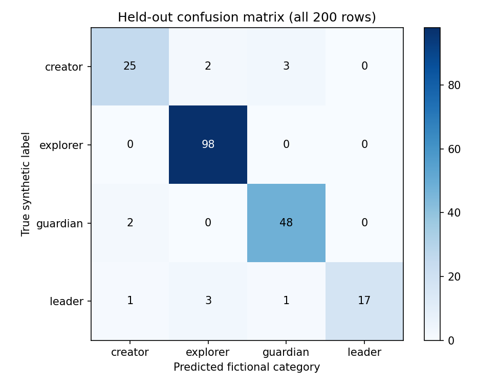
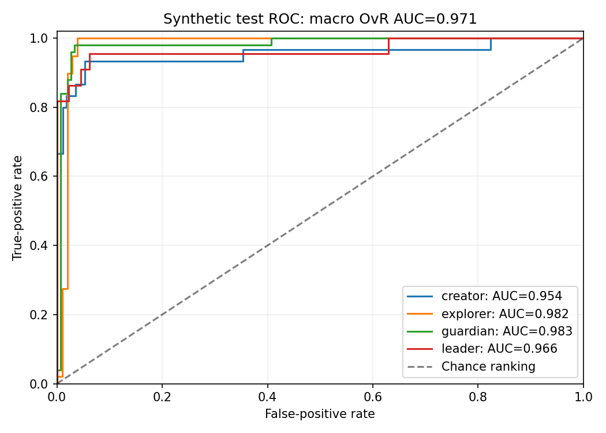
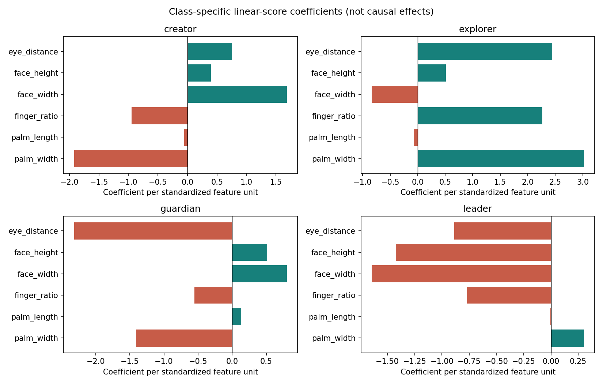

# Archetype Classifier Agent - evaluation report

All records and labels are fictional. Results describe this synthetic task only.

## Dataset and split

Source: Dr. V's instructor-provided dataset; coursework/educational demonstration only.
All 1,000 original rows and labels are retained. The generator used make_classification
with seed 317, four informative and one redundant feature, one cluster per class,
flip_y=0.04 and class_sep=1.1. Class IDs map to fictional narrative names.
Tanh-based bounded range mapping does not replace fold-fitted StandardScaler.

Dataset SHA-256: `eba5c260ea44c4aa2fc80fb2b06cfee51f9a8628bf4f5c7aa24a3d195ed65abd`.
Card SHA-256: `7182795b9128d8f677bf4a93b4ba57e494183115e21f175b9d2afc8425f30fe4`.
Split: stratified 80/20, random_state=317; train=800, test=200.
Internal row positions audit the split and are never predictors.

| Class | All | Train | Test |
| --- | ---: | ---: | ---: |
| creator | 150 | 120 | 30 |
| explorer | 492 | 394 | 98 |
| guardian | 248 | 198 | 50 |
| leader | 110 | 88 | 22 |

Feature definitions, units, and ranges are in data/dataset_card.json and docs/DATASET.md.
The CSV has no missing values or duplicate feature rows. Invalid inference values are rejected.

## Leakage prevention and model selection

The test rows are reserved before preprocessing/model selection. GridSearchCV fits
StandardScaler + LogisticRegression independently inside each training fold. The
same five shuffled stratified folds (seed 317) are used for all eight candidates.
C is [0.01, 0.1, 1.0, 10.0]; class_weight is [None, balanced].
Selection maximizes mean macro F1. No test results choose features, parameters, or threshold.

| C | Class weight | Mean CV macro F1 | Fold SD | Creator recall | Leader recall |
| ---: | --- | ---: | ---: | ---: | ---: |
| 0.01 | None | 0.574695 | 0.027934 | 0.400000 | 0.011765 |
| 0.01 | balanced | 0.798031 | 0.030914 | 0.833333 | 0.691503 |
| 0.1 | None | 0.809108 | 0.047468 | 0.733333 | 0.486928 |
| 0.1 | balanced | 0.816748 | 0.032947 | 0.875000 | 0.737908 |
| 1.0 | None | 0.850262 | 0.045892 | 0.791667 | 0.646405 |
| 1.0 | balanced | 0.835517 | 0.034419 | 0.866667 | 0.772549 |
| 10.0 | None | 0.866645 | 0.030386 | 0.841667 | 0.681046 |
| 10.0 | balanced | 0.837615 | 0.034739 | 0.875000 | 0.760784 |

Selected C=10.0, class_weight=None, mean CV macro F1=0.866645 (SD=0.030386).
Selected candidate's five fold macro F1 scores: 0.902273, 0.819366, 0.883868, 0.843862, 0.883854.
Baseline CV macro F1: 0.164991.
Convergence warnings: 0. Corrective action: None needed; no convergence warnings..
CV means support selection; they are not an independent final performance estimate.

### Class-weight experiment

For each weighting choice, compare its best C on the same training folds:

| Class | Unweighted CV recall | Balanced CV recall | Difference (balanced - unweighted) |
| --- | ---: | ---: | ---: |
| creator | 0.841667 | 0.875000 | +0.033333 |
| explorer | 0.979714 | 0.903538 | -0.076177 |
| guardian | 0.904103 | 0.868974 | -0.035128 |
| leader | 0.681046 | 0.760784 | +0.079739 |

Balanced weighting uses n_samples/(n_classes*class_count) inside the training fold.
It changes the loss, not the held-out class distribution. Minority recalls can improve
or worsen; weighting is an experiment, not an automatic winning choice. The selected
configuration wins on mean training-CV macro F1. Equal-score ties use GridSearchCV's first candidate.

## Held-out results before abstention

Explicit probability/matrix class order: ['creator', 'explorer', 'guardian', 'leader'].

| Model | Accuracy | Macro F1 |
| --- | ---: | ---: |
| Majority-class baseline (explorer) | 0.490000 | 0.164430 |
| Selected logistic regression | 0.940000 | 0.912541 |

The baseline always returns the training set's most frequent class. Macro F1 weights
all classes equally, exposing minority errors hidden by an imbalanced accuracy score.

| Class | Precision | Recall | F1 | Support |
| --- | ---: | ---: | ---: | ---: |
| creator | 0.892857 | 0.833333 | 0.862069 | 30 |
| explorer | 0.951456 | 1.000000 | 0.975124 | 98 |
| guardian | 0.923077 | 0.960000 | 0.941176 | 50 |
| leader | 1.000000 | 0.772727 | 0.871795 | 22 |

Confusion matrix: rows=true labels, columns=predicted labels, in the class order above.

```text
[25, 2, 3, 0]
[0, 98, 0, 0]
[2, 0, 48, 0]
[1, 3, 1, 17]
```



### ROC/AUC

Each class is positive versus the other three. Curves use predict_proba columns in
classifier.classes_ order. AUC measures synthetic discrimination, not classification
accuracy, calibration, or evidence of actual personality traits.

| Class | One-vs-rest AUC |
| --- | ---: |
| creator | 0.953922 |
| explorer | 0.981793 |
| guardian | 0.982933 |
| leader | 0.965526 |
| Macro OvR | 0.971043 |



## Acceptance and uncertainty

Threshold=0.60, fixed in config.py before training/test evaluation.
Accept when max predicted probability >= threshold. Otherwise category is null and
status is uncertain. This predeclared acceptance rule was not optimized against test results.
Accepted 192/200 test rows; coverage=0.960000.
Accepted-case accuracy: 0.9479166666666666.
Probabilities are uncalibrated model probabilities. Abstention does not reliably detect out-of-distribution inputs.

## Global and local explanations

Coefficients are per standardized feature unit, not per raw synthetic centimeter.
Positive/negative signs affect the class's linear score and are not causal effects.
The intercept plus all six z_j*beta_kj contributions reconstructs that score.
The response lists the three largest absolute terms. They do not sum to a probability
change, and softmax also depends on competing class scores.

- creator: strongest positive=('face_width', 1.682375268619759); strongest negative=('palm_width', -1.9181927023027574).
- explorer: strongest positive=('palm_width', 3.02594782844261); strongest negative=('face_width', -0.8374843854621901).
- guardian: strongest positive=('face_width', 0.8003093524014575); strongest negative=('eye_distance', -2.3140350657022815).
- leader: strongest positive=('palm_width', 0.30448712387766336); strongest negative=('face_width', -1.6452002355590245).

Full coefficient table: global_coefficients.json. Two actual local examples follow:

### Test row 935 (synthetic true label leader)

```json
{
  "schema_version": "1.0.0",
  "request_id": "explain-test-935",
  "status": "ok",
  "category": "leader",
  "confidence": 0.777474290722,
  "confidence_type": "uncalibrated_model_probability",
  "model_version": "archetype-lr-1.1.0",
  "acceptance_threshold": 0.6,
  "probabilities": {
    "creator": 0.000312888449,
    "explorer": 0.153484296706,
    "guardian": 0.068728524122,
    "leader": 0.777474290722
  },
  "explanation": {
    "method": "standardized_linear_contributions",
    "target_class": "leader",
    "intercept": 1.23325603,
    "sum_all_contributions": 1.73331839,
    "linear_score": 2.96657443,
    "top_features": [
      {
        "feature": "finger_ratio",
        "standardized_value": 1.56973412,
        "contribution": -1.20883729,
        "direction": "opposes"
      },
      {
        "feature": "face_width",
        "standardized_value": -0.68451982,
        "contribution": 1.12617216,
        "direction": "supports"
      },
      {
        "feature": "eye_distance",
        "standardized_value": -1.02285482,
        "contribution": 0.90652254,
        "direction": "supports"
      }
    ]
  },
  "reason": null,
  "error": null,
  "warnings": [
    "Fictional category; not a personal assessment.",
    "Synthetic data do not validate relationships between measurements and personal traits.",
    "Probabilities are uncalibrated; contributions explain linear scores, not causal effects."
  ],
  "processing_ms": 0.123
}
```

### Test row 879 (synthetic true label guardian)

```json
{
  "schema_version": "1.0.0",
  "request_id": "explain-test-879",
  "status": "ok",
  "category": "guardian",
  "confidence": 0.930584480082,
  "confidence_type": "uncalibrated_model_probability",
  "model_version": "archetype-lr-1.1.0",
  "acceptance_threshold": 0.6,
  "probabilities": {
    "creator": 0.026198893711,
    "explorer": 7.41527e-07,
    "guardian": 0.930584480082,
    "leader": 0.04321588468
  },
  "explanation": {
    "method": "standardized_linear_contributions",
    "target_class": "guardian",
    "intercept": 0.04034265,
    "sum_all_contributions": 5.13023527,
    "linear_score": 5.17057791,
    "top_features": [
      {
        "feature": "eye_distance",
        "standardized_value": -1.32488929,
        "contribution": 3.06584026,
        "direction": "supports"
      },
      {
        "feature": "palm_width",
        "standardized_value": -0.80148859,
        "contribution": 1.13189605,
        "direction": "supports"
      },
      {
        "feature": "finger_ratio",
        "standardized_value": -1.18077808,
        "contribution": 0.65149774,
        "direction": "supports"
      }
    ]
  },
  "reason": null,
  "error": null,
  "warnings": [
    "Fictional category; not a personal assessment.",
    "Synthetic data do not validate relationships between measurements and personal traits.",
    "Probabilities are uncalibrated; contributions explain linear scores, not causal effects."
  ],
  "processing_ms": 0.048
}
```



## Misclassifications

- Test row 395: true=leader, predicted=explorer, max probability=0.777738, accepted=True.
- Test row 171: true=leader, predicted=creator, max probability=0.680236, accepted=True.
- Test row 96: true=guardian, predicted=creator, max probability=0.531360, accepted=False.
- Test row 751: true=creator, predicted=explorer, max probability=0.982032, accepted=True.
- Test row 669: true=leader, predicted=explorer, max probability=0.861000, accepted=True.
Full synthetic vectors and outcomes: misclassifications.json.

## Limits and portability

The data were generated, bounded, and jointly labeled as fictional clusters; they are not
measurements of people. Arbitrary teaching ranges and noisy labels do not validate biological
relationships. A linear boundary may miss nonlinear structure and performance can shift
on new distributions. No personal, demographic, health, or ability claims are justified.

The complete fitted sklearn pipeline is saved. A JSON export of the same scaler, coefficients,
intercepts, and class order supports standard-library inference on Python 3.13.5. Desktop
save/load and portable-equivalence checks are recorded in evidence. Physical Raspberry Pi
runtime results must be generated on the user's hardware; none are claimed here.
